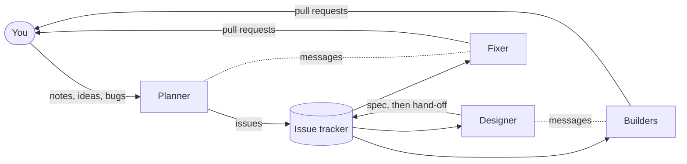

# agent-crew

A planner, a designer, builders and a fixer for [Claude Code](https://claude.com/claude-code), working as one crew on one project.

Each agent is its own Claude Code session with one job. They share the project, talk to each other, and keep their work on your issue tracker. You talk to the planner, review pull requests, and make the decisions.

```bash
npx github:laasilva/agent-crew init
```

## Why a crew

One agent doing everything has to hold the plan, the design, the code and the bugs in a single context. A crew splits that up.

| With one agent | With a crew |
| --- | --- |
| One long context that fills up and forgets | Each agent holds only its own job |
| You wait while it does one thing at a time | Design, features and fixes move at once |
| You repeat decisions when a session ends | Decisions live on the issue, where every agent reads them |
| You route every task yourself | The planner analyses, writes the issue and routes it |
| Parallel sessions overwrite each other | Each agent has its own worktree, and claims an issue before starting |
| Hard to tell what's verified | Every report says what was checked and what wasn't |

## How it works



| Role | Does | Doesn't |
| --- | --- | --- |
| **Planner** | Analyses, writes issues, routes work, tracks the queue | Build or decide for you |
| **Designer** | Specs, mockups, flows and assets a builder can implement | Write production code |
| **Builder** | Implements features from issues, with tests | Fix unrelated bugs or redesign |
| **Fixer** | Reproduces and fixes bugs and unreliable tests | Build features |
| **You** | Decide, review and merge | |

The agents follow one shared [protocol](templates/PROTOCOL.md). In short:

1. **The board is the source of truth.** Work, decisions and hand-offs go on the issue, so nothing depends on one session's memory.
2. **Claim before you start.** An agent assigns the issue and comments with its name, so that two agents never build the same thing.
3. **Issue, branch, pull request, stop.** Only you merge. Each agent keeps one pull request open at a time.
4. **Agents can ask each other, but only you can approve.** A message from another agent is never permission.
5. **Say what you verified.** Reports separate what was tested from what wasn't.

## Install

You need [Claude Code](https://claude.com/claude-code), Node 18 or later, git, and the GitHub CLI (`gh`) signed in.

From your project's folder:

```bash
npx github:laasilva/agent-crew init
```

This adds three things, and touches nothing else:

- `.claude/agents/`: one file per role
- `.claude/crew/PROTOCOL.md`: the shared rules
- A marked section in `CLAUDE.md` with the roster. Your own text is kept.

Then commit them, so that every worktree has them:

```bash
git add .claude CLAUDE.md && git commit -m "Add the agent crew"
```

### Options

| Option | Does |
| --- | --- |
| `--builders <n>` | How many builders the roster lists. The default is 2 |
| `--no-designer` | Leaves the designer out |
| `--no-fixer` | Leaves the fixer out |
| `--dir <path>` | Installs into another folder |
| `--dry-run` | Shows what would change, and changes nothing |
| `--force` | Replaces files that already exist |

To remove it:

```bash
npx github:laasilva/agent-crew uninstall
```

## Start the crew

Open one terminal per agent, in your project's folder:

```bash
claude --agent planner
```

```bash
claude --agent designer --worktree designer
```

```bash
claude --agent builder --worktree builder-1
```

```bash
claude --agent builder --worktree builder-2
```

```bash
claude --agent fixer --worktree fixer
```

The planner works in your main folder, because it only reads code and writes issues. Every other agent gets its own git worktree, so their changes never collide.

You don't have to start everyone. A planner and one builder is a fine way to begin.

## A day with the crew

1. **You tell the planner what you noticed:** "Checkout fails when the cart is empty, and the settings page looks dated."
2. **The planner investigates and writes two issues.** The bug goes to the fixer. The settings page goes to the designer, with the decisions it needs from you.
3. **The fixer reproduces the bug,** fixes it, and opens a pull request.
4. **The designer shows you two directions.** You pick one, and it hands the spec to a builder on the issue.
5. **A builder implements it** and opens a pull request.
6. **You review and merge.** Each agent picks up its next issue.

You made two decisions and reviewed two pull requests. The routing, the hand-offs and the context all stayed with the crew.

## Make it yours

Everything installed is plain Markdown in your repository.

- **Change a role:** edit its file in `.claude/agents/`.
- **Change the rules:** edit `.claude/crew/PROTOCOL.md`. For example, you could allow more than one open pull request per agent, or use a different tracker.
- **Give builders lanes:** tell the planner, or write the lanes into the roster in `CLAUDE.md`, such as "builder-1: backend" and "builder-2: frontend".
- **Add a role:** copy a role file, change its name and its job, and add it to the roster.

Your project's own rules stay in your `CLAUDE.md`. The crew's files carry no coding style, design taste or tooling choices.

## Good to know

- **Agents talking to each other.** Where your Claude Code has messaging between sessions, the agents use it. Where it doesn't, they use issue comments, which the protocol requires for anything lasting anyway. Either way, the crew works.
- **You are the limit.** Five agents can open pull requests faster than one person can review them. Start small, and add agents when you're keeping up.
- **It uses more tokens.** Every agent is a full session.
- **Agents can share one GitHub account.** That's why each one signs its comments with its session's name.
- **What's tested.** The installer has automated tests. The workflow itself comes from daily use in the Claude desktop app, and the terminal commands above follow Claude Code's documented options. If something doesn't work in your setup, please open an issue.

## Develop

```bash
npm test
```

## Licence

MIT
